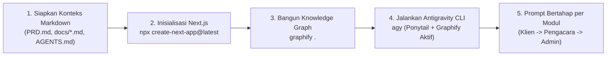

# Tahapan Konfigurasi Antigravity CLI (`agy`) dengan Plugin Ponytail & Graphify

Panduan ini berisi langkah-langkah lengkap menyiapkan **Antigravity CLI (`agy`)** yang dikombinasikan dengan:
1. **Plugin Ponytail (`DietrichGebert/ponytail`):** Ruleset & plugin anti-over-engineering berbasis prinsip **YAGNI (*You Aren't Gonna Need It*)** agar AI coding agent fokus menulis kode Next.js yang ringkas, bersih, dan hemat token tanpa abstraksi berlebihan.
2. **Plugin / Skill Graphify (`graphifyy`):** Pembangun *Knowledge Graph* lokal berbasis AST (Tree-sitter) yang memetakan seluruh file konteks Markdown (`PRD.md`, `docs/*.md`) dan kode Next.js ke dalam graf struktur proyek sehingga agen tidak perlu membaca ulang seluruh file mentah di setiap prompt.

---

## Tahap 1: Cara Download & Install Antigravity CLI (`agy`) di Windows

Antigravity CLI (`agy`) didistribusikan sebagai *standalone native binary* (`agy.exe`) yang diinstal langsung ke direktori lokal pengguna (`%LOCALAPPDATA%\agy\bin`) dan otomatis didaftarkan ke `PATH` Windows.

### 1.1 Download & Install `agy` (Pilih Salah Satu Metode)

#### Opsi A: Menggunakan Windows PowerShell (Direkomendasikan)
Buka **PowerShell** (atau terminal di dalam Antigravity IDE), lalu jalankan perintah resmi berikut:

```powershell
irm https://antigravity.google/cli/install.ps1 | iex
```

#### Opsi B: Menggunakan Command Prompt (CMD)
Jika menggunakan **CMD**, jalankan perintah berikut:

```cmd
curl -fsSL https://antigravity.google/cli/install.cmd -o install.cmd && install.cmd && del install.cmd
```

#### Opsi C: Melalui Command Palette di Antigravity IDE
1. Tekan `Ctrl + Shift + P` untuk membuka **Command Palette**.
2. Ketik dan pilih **`Antigravity: Install CLI`** (atau `Install 'agy' command in PATH`).

---

### 1.2 Refresh PATH & Verifikasi Instalasi
Setelah proses download selesai, tutup dan buka kembali terminal PowerShell Anda (atau muat ulang variabel `PATH` pada sesi saat ini), lalu cek versinya:

```powershell
# Muat ulang PATH di sesi PowerShell saat ini tanpa harus menutup terminal
$env:Path = [System.Environment]::GetEnvironmentVariable("Path","Machine") + ";" + [System.Environment]::GetEnvironmentVariable("Path","User")

# Cek apakah agy sudah terdeteksi
agy --version
agy --help
```
> *Catatan: Jika `agy` belum langsung dikenali, pastikan folder `$env:LOCALAPPDATA\agy\bin` sudah ada di dalam `PATH` Anda.*

---

### 1.3 Menjalankan & Autentikasi Pertama Kali
Masuk ke folder proyek **HiLaw** dan jalankan `agy` untuk menghubungkan akun Anda:

```powershell
# Masuk ke direktori proyek HiLaw
cd C:\Users\ASUS\HiLaw

# Jalankan Antigravity CLI
agy
```
> Saat pertama kali dijalankan, `agy` akan membuka jendela browser untuk proses login (Google OAuth) atau mengikuti instruksi autentikasi di layar. Untuk keluar dari sesi TUI kapan saja, tekan `Ctrl+D` dua kali atau ketik `/exit`.

### 1.2 Konfigurasi `settings.json` Antigravity CLI
Antigravity CLI menyimpan pengaturannya di `~/.gemini/antigravity-cli/settings.json` (pada Windows: `C:\Users\ASUS\.gemini\antigravity-cli\settings.json`).

Anda dapat memastikan file konfigurasi dasar tersedia:
```powershell
New-Item -ItemType Directory -Force -Path "$HOME\.gemini\antigravity-cli"
```

Contoh isi `~/.gemini/antigravity-cli/settings.json`:
```json
{
  "theme": "default",
  "autoApproveSafeReads": true
}
```

---

## Tahap 2: Instalasi & Konfigurasi Plugin **Ponytail**

**Ponytail** memaksa AI agent berpikir seperti *pragmatic senior developer*: menggunakan fitur bawaan platform/Next.js terlebih dahulu, tidak membuat komponen atau abstraksi yang belum diminta, serta menghemat pemakaian token.

### 2.1 Instalasi Ponytail via Antigravity Plugin Manager (Direkomendasikan)
Jalankan perintah berikut di terminal PowerShell:

```powershell
agy plugin install https://github.com/DietrichGebert/ponytail
```

*(Alternatif: Jika Anda ingin memasang Ponytail secara spesifik di dalam workspace proyek HiLaw agar ikut tersimpan di Git)*:
```powershell
# Buat folder plugin lokal di dalam workspace .agents
New-Item -ItemType Directory -Force -Path "C:\Users\ASUS\HiLaw\.agents\plugins"

# Clone repositori Ponytail ke dalam folder plugins workspace
git clone https://github.com/DietrichGebert/ponytail "C:\Users\ASUS\HiLaw\.agents\plugins\ponytail"
```

### 2.2 Mengaktifkan & Mengatur Ponytail di Dalam Sesi `agy`
1. Pastikan plugin Ponytail berstatus aktif:
   ```powershell
   agy plugin enable ponytail
   ```
2. Di dalam sesi interaktif `agy`, Ponytail menyuntikkan **Decision Ladder (Tangga Keputusan YAGNI)**:
   - **Level 1:** Gunakan elemen HTML/CSS & API native browser atau fitur standar Next.js App Router.
   - **Level 2:** Gunakan komponen/state yang sudah ada di proyek (`src/data/mockData.ts`, `src/types/hilaw.ts`).
   - **Level 3:** Baru tulis komponen kustom seminimal mungkin sesuai kebutuhan UI.
3. Jika ingin mengatur tampilan status band Ponytail di dalam sesi CLI, gunakan perintah slash `/ponytail` (jika didukung oleh versi ekstensi yang terpasang).

---

## Tahap 3: Instalasi & Konfigurasi Plugin **Graphify**

**Graphify** (`graphifyy` di PyPI) membaca kode sumber, skema ERD, dan file Markdown (`PRD.md`, `docs/DESIGN_SYSTEM.md`, `docs/ERD_AND_MOCK_SCHEMA.md`) lalu mengubahnya menjadi *Knowledge Graph* lokal di folder `graphify-out/`.

### 3.1 Instalasi Paket CLI `graphifyy`
Pastikan Python 3.10+ sudah terpasang, lalu install menggunakan `pip` atau `uv` (perhatikan huruf **`yy`** ganda pada nama paket PyPI `graphifyy`):

```powershell
# Opsi A: Menggunakan pip
pip install graphifyy

# Opsi B: Menggunakan uv (jika memakai uv)
uv tool install graphifyy
```

### 3.2 Integrasi Graphify ke Antigravity CLI
Daftarkan skill/hook Graphify ke dalam ekosistem Antigravity agar agen otomatis membaca `graphify-out/GRAPH_REPORT.md` sebelum mencari file secara manual:

```powershell
# Masuk ke direktori proyek HiLaw
cd C:\Users\ASUS\HiLaw

# Pasang integrasi khusus Antigravity
graphify antigravity install
```
*(Catatan: Jika ingin mendaftarkan secara umum ke semua agen yang terdeteksi, Anda juga dapat menjalankan `graphify install`).*

### 3.3 Membangun Knowledge Graph Proyek HiLaw
Setiap kali Anda selesai memperbarui file konteks Markdown atau menambahkan halaman Next.js baru, jalankan:

```powershell
# Dari terminal PowerShell di C:\Users\ASUS\HiLaw
graphify .
```
Atau langsung dari dalam sesi chat Antigravity CLI (`agy`):
```text
/graphify .
```

**Hasil yang dibuat oleh Graphify:**
- `graphify-out/GRAPH_REPORT.md` — Ringkasan arsitektur, relasi antar dokumen konteks (`PRD.md`, `DESIGN_SYSTEM.md`, `ERD_AND_MOCK_SCHEMA.md`), dan peta komponen Next.js.
- `graphify-out/graph.json` — Basis data graf lokal yang bisa di-query oleh agen tanpa memboroskan konteks token.
- `graphify-out/graph.html` — Visualisasi graf interaktif yang bisa dibuka di browser.

---

## Tahap 4: Alur Kerja (Workflow) Pembangunan Next.js HiLaw dengan `agy` + Ponytail + Graphify

Berikut adalah urutan langkah terbaik saat Anda siap mengenerate kode Next.js untuk **HiLaw**:



### Langkah Praktis Eksekusi:

1. **Inisialisasi Proyek Next.js (di folder `C:\Users\ASUS\HiLaw`):**
   ```powershell
   npx create-next-app@latest . --typescript --tailwind --eslint --app --src-dir --import-alias "@/*"
   ```
2. **Generate Knowledge Graph Pertama Kali:**
   ```powershell
   graphify .
   ```
3. **Buka Antigravity CLI (`agy`) dan Gunakan Contoh Prompt Berikut:**
   - **Prompt 1 (Fondasi & Mock Data):**
     > *"Berdasarkan konteks di `PRD.md`, `docs/DESIGN_SYSTEM.md`, dan `docs/ERD_AND_MOCK_SCHEMA.md`, buatkan file `src/types/hilaw.ts` dan `src/data/mockData.ts` beserta Navbar dengan Role Switcher (Klien, Pengacara, Admin) dan indikator saldo LawToken."*
   - **Prompt 2 (Beranda Halodoc-Style & Direktori Pengacara):**
     > *"Buatkan halaman utama `src/app/page.tsx` dengan gaya Halodoc dan palet Pastel Legal Trust sesuai `docs/DESIGN_SYSTEM.md`, lengkap dengan fitur filter spesialis pengacara dan simulasi modal Top-Up LawToken Midtrans Snap."*
   - **Prompt 3 (Ruang Konsultasi, Dashboard Pengacara & Admin):**
     > *"Buatkan halaman ruang konsultasi Chat/Video Call beserta Legal Resume, halaman Dashboard Pengacara (`/lawyer-dashboard`), dan Dashboard Admin (`/admin`)."*
