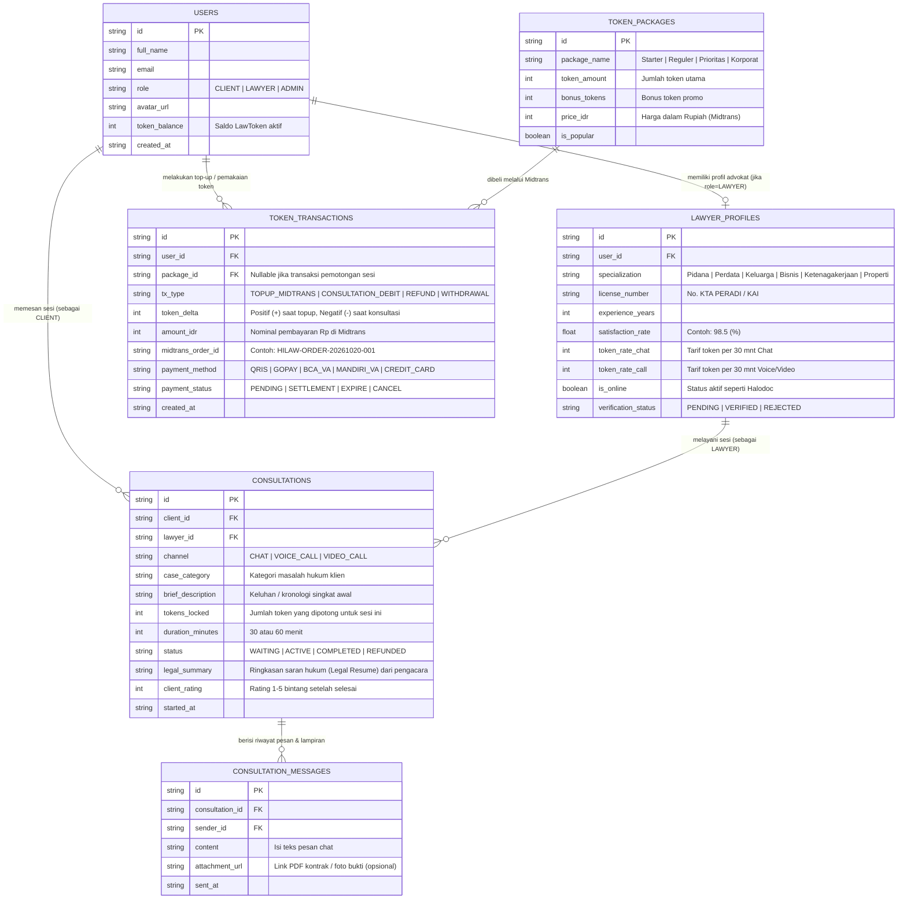
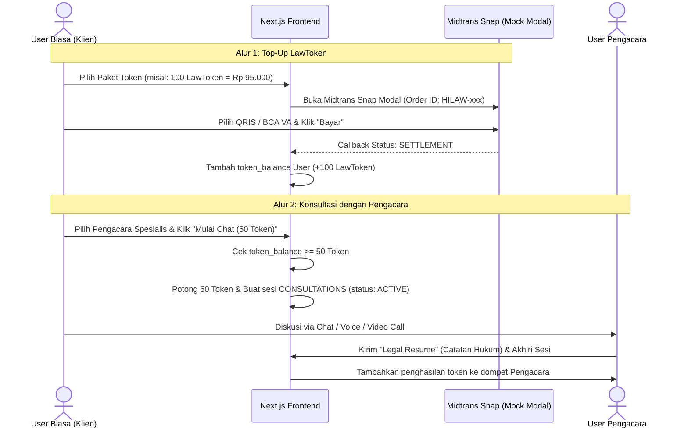

# Simple ERD & Frontend Mock Schema — HiLaw

Sesuai kebutuhan tahap awal (**Frontend-First menggunakan Next.js** tanpa backend aktif), skema database dirancang **simpel, ringkas (6 tabel utama), dan langsung dipetakan menjadi TypeScript Interfaces & Mock State**. Desain ini sudah mencakup 3 level user (`CLIENT`, `LAWYER`, `ADMIN`), sistem **LawToken**, pembayaran **Midtrans**, dan fitur konsultasi (**Chat, Telepon, Video Call**).

---

## 1. Entity Relationship Diagram (ERD Simpel)



---

## 2. Alur Transaksi LawToken & Midtrans (State Flow di Next.js)



---

## 3. Kontrak Data TypeScript untuk Next.js (`src/types/hilaw.ts`)

Salin struktur berikut saat mulai membuat komponen di Next.js agar seluruh halaman memiliki tipe data yang konsisten:

```typescript
export type UserRole = 'CLIENT' | 'LAWYER' | 'ADMIN';

export type LegalSpecialization =
  | 'Hukum Keluarga & Waris'
  | 'Hukum Bisnis & Kontrak'
  | 'Hukum Pidana'
  | 'Hukum Perdata & Hutang Piutang'
  | 'Hukum Ketenagakerjaan (PHI)'
  | 'Pertanahan & Properti'
  | 'HKI & Pajak';

export interface User {
  id: string;
  fullName: string;
  email: string;
  role: UserRole;
  avatarUrl: string;
  tokenBalance: number;
}

export interface LawyerProfile {
  id: string;
  userId: string;
  fullName: string;
  avatarUrl: string;
  specialization: LegalSpecialization;
  subSpecialties: string[];
  licenseNumber: string; // Contoh: "PERADI-2018-09421"
  university: string;
  experienceYears: number;
  satisfactionRate: number; // Contoh: 99
  totalConsultations: number;
  tokenRateChat: number; // Contoh: 50 (setara Rp 50.000)
  tokenRateCall: number; // Contoh: 90 (setara Rp 90.000)
  isOnline: boolean;
  verificationStatus: 'PENDING' | 'VERIFIED' | 'REJECTED';
}

export interface TokenPackage {
  id: string;
  packageName: string;
  tokenAmount: number;
  bonusTokens: number;
  priceIdr: number;
  isPopular?: boolean;
  description: string;
}

export interface TokenTransaction {
  id: string;
  userId: string;
  userName: string;
  txType: 'TOPUP_MIDTRANS' | 'CONSULTATION_DEBIT' | 'REFUND' | 'WITHDRAWAL';
  tokenDelta: number;
  amountIdr: number;
  midtransOrderId?: string;
  paymentMethod?: 'QRIS' | 'GOPAY' | 'BCA_VA' | 'MANDIRI_VA' | 'CREDIT_CARD';
  paymentStatus: 'PENDING' | 'SETTLEMENT' | 'EXPIRE';
  createdAt: string;
}

export interface ConsultationSession {
  id: string;
  clientId: string;
  clientName: string;
  lawyerId: string;
  lawyerName: string;
  lawyerSpecialty: LegalSpecialization;
  channel: 'CHAT' | 'VOICE_CALL' | 'VIDEO_CALL';
  briefDescription: string;
  tokensLocked: number;
  durationMinutes: number;
  status: 'WAITING' | 'ACTIVE' | 'COMPLETED';
  legalSummary?: {
    issueAnalysis: string;
    legalBasis: string;
    recommendedAction: string[];
  };
  startedAt: string;
}
```
